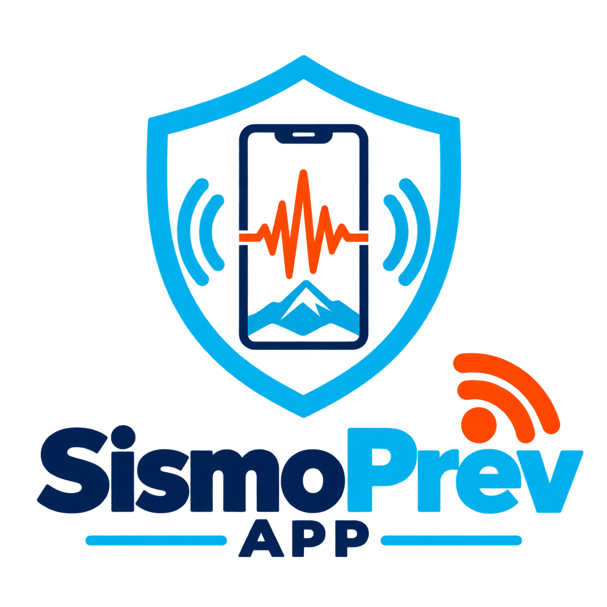

# 🛡️ SISMO-PREV APP — Red Comunitaria de Alerta Sísmica Temprana y Resiliencia

> **Desafío 02:** "Sensores al servicio de la comunidad"  
> **Evento:** Rally Latinoamericano de Innovación 2026  
> **Equipo:** FENIX CODE (Nicaragua 🇳🇮)



---

## 📌 1. Visión del Proyecto
**SISMO-PREV** es un ecosistema integral de alerta temprana, simulación escolar y estimación de magnitud sísmica diseñado para América Latina. Transforma **smartphones en desuso o de bajo costo** en una red densa de sismógrafos urbanos distribuidos mediante acelerómetros MEMS integrados (muestreo a 50 Hz) y el algoritmo geofísico **STA/LTA** acoplado a un filtro de aprendizaje automático para detección inmediata de la Onda P.

Cuenta con un **Centro de Mando / Dashboard Web en tiempo real** con sismógrafo gráfico continuo, semáforo de amenaza tri-estado, simulador de evacuación escolar y un copiloto de Inteligencia Artificial (Google Gemini 2.5 Flash / Ollama) para el análisis técnico de daños estructurales para bomberos y protección civil.

---

## 🏗️ 2. Arquitectura del Ecosistema

```
                       ┌────────────────────────────────────────┐
                       │   SISMO-PREV CENTRAL SERVER (FastAPI)  │
                       │   • WebSocket en tiempo real           │
                       │   • Dashboard Chart.js Seismograph     │
                       │   • IA Copilot (Gemini / Ollama)       │
                       │   • Motor de Simulacros Escolares      │
                       └───────────────────▲────────────────────┘
                                           │
                        ┌──────────────────┴──────────────────┐
                        │ REST / WebSockets / Cloud Messaging │
                        └──────────────────▲──────────────────┘
                                           │
               ┌───────────────────────────┴───────────────────────────┐
               │                                                       │
  ┌────────────┴─────────────┐                           ┌─────────────┴────────────┐
  │   NODO CELULAR ACTIVO 1  │  ◄── BLE Mesh P2P ────►   │   NODO CELULAR ACTIVO 2  │
  │ • Acelerómetro 50 Hz     │  (Google Nearby Offline)  │ • Acelerómetro 50 Hz     │
  │ • Trigger Onda P STA/LTA │                           │ • Trigger Onda P STA/LTA │
  │ • Sirena de Alerta       │                           │ • Sirena de Alerta       │
  └──────────────────────────┘                           └──────────────────────────┘
```

---

## 📱 3. Componentes Principales

### A. Aplicación Móvil Android (`cliente_movil_android`)
- **Algoritmo STA/LTA (Short-Term Average / Long-Term Average):** Detección in situ de variaciones energéticas abruptas en el suelo (PGA - *Peak Ground Acceleration*).
- **Filtro de Falsos Positivos:** Distinción de vibraciones humanas vs. ondas sísmicas reales.
- **Canales de Comunicación Hiper-Redundantes:**
  - **Internet:** WebSockets y REST API hacia el servidor central.
  - **Offline Mesh:** Enlace inalámbrico punto a punto (Bluetooth Low Energy / Google Nearby Connections) para transmitir alertas de teléfono a teléfono cuando la red eléctrica o celular colapsa.
- **Sirena y Alerta de Simulacro:** Activación sincronizada de audio y vibración ante sismos reales o simulacros comunitarios.

### B. Servidor Central & Centro de Monitoreo (`servidor_monitoreo`)
- **FastAPI + WebSockets:** Conexión persistente de baja latencia con los sensores móviles.
- **Sismógrafo en Tiempo Real:** Visualización continua en Chart.js de la aceleración del terreno y cálculo de PGA.
- **Semáforo de Amenaza Sísmica:**
  - 🟢 **VERDE:** Condición normal de reposo.
  - 🟠 **NARANJA:** Modo Simulacro Escolar Activo.
  - 🔴 **ROJO:** Alerta de Sismo Real (Evacuación Inmediata).
- **Asistente de Inteligencia Artificial:** Integración de Google Gemini API y motor local Ollama para generación instantánea de informes de daños y prioridades de rescate.

---

## 🚀 4. Guía de Ejecución Rápida (1 Clic) y Descarga

El proyecto incluye scripts automáticos que preparan el entorno virtual, instalan las dependencias e inician el servidor de monitoreo automáticamente:

### 🐧 En Linux / macOS:
Abre una terminal en la raíz del proyecto y ejecuta:
```bash
chmod +x iniciar_servidor.sh
./iniciar_servidor.sh
```

### 🪟 En Windows:
Simplemente haz **doble clic** en:
```cmd
iniciar_servidor.bat
```
*(O ejecútalo desde el Símbolo del Sistema / PowerShell).*

---

### 🌐 Accesos del Servidor una vez Iniciado:
- **📊 Centro de Monitoreo / Dashboard:** `http://localhost:8080`
- **📱 App Móvil Versión Web (PWA):** `http://localhost:8080/app/`
- **📥 Descarga Directa del APK:** `http://localhost:8080/descargar-apk`
- **📡 Feed Oficial de Sismos (Nicaragua & USGS):** `http://localhost:8080/api/seismic/public`

---

### 📲 5. Descarga e Instalación del APK de Android

Tienes dos formas directas de obtener e instalar la aplicación en tu smartphone:

1. **Desde este mismo repositorio de GitHub:**
   - Descarga directa del archivo compilado: [`servidor_monitoreo/sismoprev.apk`](servidor_monitoreo/sismoprev.apk).
2. **Desde el Servidor en Vivo:**
   - Haz clic en el botón superior **📥 Descargar APK** del Dashboard o ingresa desde tu celular al enlace `/descargar-apk`.
3. **Instalación en el teléfono:**
   - Abre el archivo `.apk` descargado en tu Android.
   - Si el sistema te lo solicita, permite *"Instalar aplicaciones de fuentes desconocidas"*.
   - ¡Listo! La app se conectará automáticamente a la red comunitaria.

---

## 🏆 6. Equipo de Desarrollo
- **FENIX CODE** (Nicaragua 🇳🇮)
- **Evento:** Rally Latinoamericano de Innovación 2026.
- **Desafío 02:** "Sensores al servicio de la comunidad".

---

## 🚧 7. Estado del Proyecto & Próximas Funciones (Roadmap)

> [!NOTE]
> **Proyecto en Desarrollo Activo:** Esta versión constituye el prototipo funcional presentado para el **Rally Latinoamericano de Innovación 2026**. El sistema continuará su ciclo de evolución con el fin de robustecer la resiliencia comunitaria y la interoperabilidad con centros sismológicos nacionales (INETER en Nicaragua).
> Para revisar las 20 propuestas de expansión y aprovechamiento de hardware móvil, consulta [`PROPUESTAS_INNOVACION_SENSORES.md`](PROPUESTAS_INNOVACION_SENSORES.md).

### 🔮 Funciones Planificadas para Futuras Versiones:
- [x] **Redes Sísmicas Públicas Integradas:** Monitoreo oficial en vivo de sismos en Nicaragua y Centroamérica con USGS.
- [x] **Tonos Oficiales de Alarma:** SASMEX con voz sintetizada en español, EAS Nacional y selector en configuración.
- [ ] **Malla Descentralizada P2P Autónoma:** Enrutamiento multipunto dinámico (*Multi-hop BLE Mesh*) para propagación de alertas en zonas rurales sin cobertura móvil.
- [ ] **Inferencia Neuronal Edge (TinyML):** Despliegue de modelo TensorFlow Lite ultraligero directamente en el procesador del teléfono para filtrado extremo de falsos positivos mecánicos.
- [ ] **Pasarela de Alertas Masivas por SMS y Cell Broadcast:** Integración con protocolos de emergencia CAP 1.2 (*Common Alerting Protocol*) para radiodifusión celular de defensa civil.
- [ ] **Mapas Vectoriales Topográficos Offline:** Integración de teselas MBTiles de zonas de seguridad escolar y albergues sin requerir descarga de datos en línea.
- [ ] **Sincronización Cloud con Firebase Cloud Messaging (FCM):** Canal de empuje en milisegundos con soporte para despertar teléfonos en reposo (*Doze Mode*).

